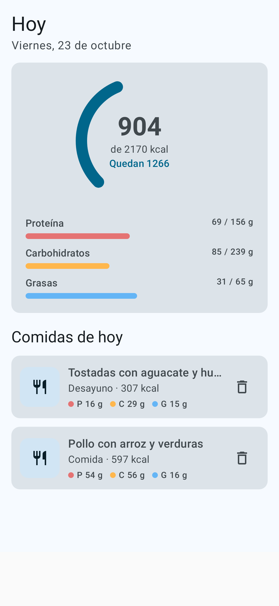
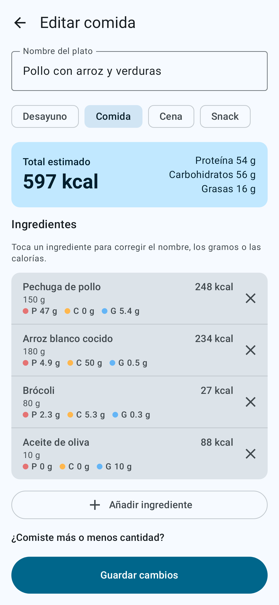
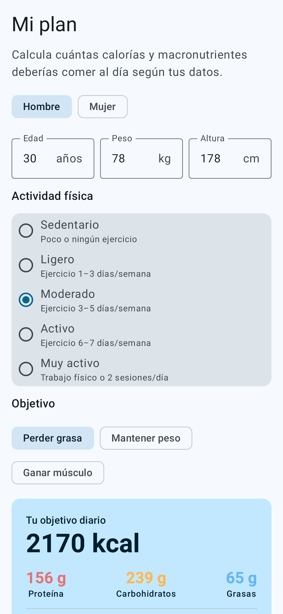
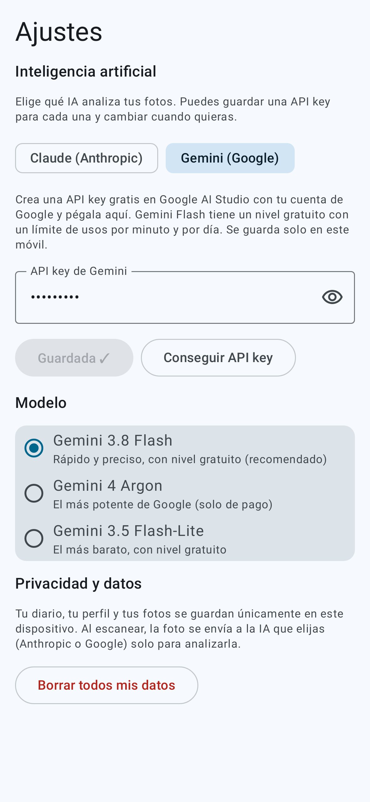

# NutriScan · Contador de calorías con IA para Android

Haz una foto a tu plato o a un producto y la app estima las **calorías y macronutrientes** (proteína, carbohidratos y grasas) de cada ingrediente usando IA: **Claude** (Anthropic) o **Gemini** (Google), la que prefieras. Después puedes corregir lo que haga falta y guardarlo en tu diario. Además, calcula **cuánto deberías comer** según tu peso, altura, edad, actividad y objetivo.

Todos tus datos (diario, fotos, plan y API key) se guardan **solo en tu móvil**.

| Hoy | Revisar comida | Mi plan | Ajustes |
|---|---|---|---|
|  |  |  |  |

## Qué hace

- **Escanear con la cámara** o elegir una foto de la galería. La IA identifica el plato o el producto (si se ve la etiqueta nutricional, la usa) y devuelve una lista de ingredientes con gramos, kcal y macros.
- **Corregir fácilmente**: toca un ingrediente para cambiar el nombre, los gramos o las calorías (al cambiar los gramos se recalcula todo solo). Puedes quitar o añadir ingredientes, ajustar la ración (½, −25 %, +25 %, ×2) o decirle a la IA qué se ha equivocado («es tofu, no pollo») y volver a analizar.
- **Añadir a mano**, sin foto.
- **Plan nutricional**: calorías diarias y gramos de proteína, carbohidratos y grasas con la fórmula de Mifflin-St Jeor, además de metabolismo basal, gasto diario, IMC y agua recomendada.
- **Diario de hoy** con anillo de calorías y barras de macros, e **historial** por días.
- **Privacidad**: base de datos local (Room), sin cuentas ni servidores propios. La foto solo sale del móvil para analizarla en la API de la IA elegida (Anthropic o Google).

## Instalarla en tu Android

1. Abre en el móvil la página de **Releases** de este repositorio y descarga `NutriScan.apk` de la release *latest*.
2. Ábrelo y permite «Instalar apps desconocidas» para tu navegador o gestor de archivos cuando te lo pida.
3. Requiere Android 8.0 o superior.

Cada cambio en la rama `main` vuelve a compilar el APK automáticamente (GitHub Actions) y actualiza esa release. Las nuevas versiones se instalan encima de la anterior sin perder tus datos.

## Configurar la IA

En **Ajustes → Inteligencia artificial** elige qué IA usar. Puedes guardar una API key de cada una y cambiar cuando quieras.

**Opción gratuita: Gemini (Google)**
1. Entra en [Google AI Studio](https://aistudio.google.com/apikey) con tu cuenta de Google y pulsa «Create API key».
2. En la app: **Ajustes → Gemini (Google)**, pega la key y pulsa **Guardar**.
3. Modelos: **Gemini 3.8 Flash** (recomendado, con nivel gratuito), **Gemini 4 Argon** (el más potente, solo de pago) o **Gemini 3.5 Flash-Lite** (el más barato, con nivel gratuito). El nivel gratuito tiene un límite de usos por minuto y por día.

**Claude (Anthropic)**
1. Crea una API key en [console.anthropic.com](https://console.anthropic.com/settings/keys) (necesita saldo en la cuenta: cada foto cuesta unos 2–4 céntimos con Opus y bastante menos con Haiku).
2. En la app: **Ajustes → Claude (Anthropic)**, pega la key y pulsa **Guardar**.
3. Modelos: **Claude Opus 5.5** (el más preciso), **Sonnet 5.5** (equilibrado) o **Haiku 5.5** (el más rápido y barato).

## Detalles técnicos

- Kotlin + Jetpack Compose (Material 3), Room, DataStore. `minSdk 26`, `targetSdk 36`.
- Análisis con el [SDK oficial de Claude para Java](https://github.com/anthropics/anthropic-sdk-java) (v3): imagen en base64 + **salida estructurada** con un esquema JSON (`output_config.format`), esfuerzo `medium` y, en Opus y Sonnet, `fallbacks: "default"` para que la API reintente automáticamente con otro modelo si su filtro de seguridad rechazara una foto.
- Gemini se llama con la API REST `generateContent` (`responseMimeType: application/json` + `responseSchema`), reintentando automáticamente si el servidor está saturado.
- Código principal:
  - `app/src/main/java/com/nutriscan/app/ai/FoodPrompt.kt` — prompt y esquema comunes.
  - `app/src/main/java/com/nutriscan/app/ai/ClaudeAnalyzer.kt` y `GeminiAnalyzer.kt` — llamada a cada IA.
  - `app/src/main/java/com/nutriscan/app/domain/NutritionPlan.kt` — cálculo del plan.
  - `app/src/main/java/com/nutriscan/app/ui/screens/` — pantallas.

### Compilar en tu ordenador

```bash
./gradlew assembleRelease          # APK en app/build/outputs/apk/release/
./gradlew testDebugUnitTest        # tests (plan, petición a Claude, capturas)
```

> Las estimaciones son orientativas y no sustituyen el consejo de un profesional sanitario.
